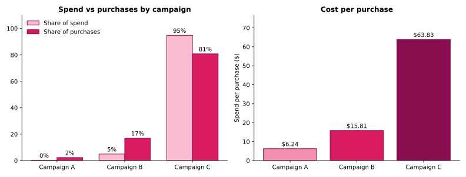
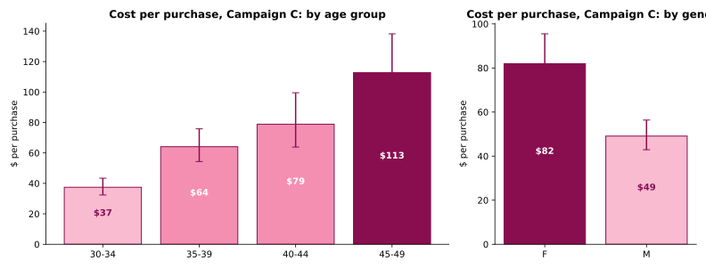
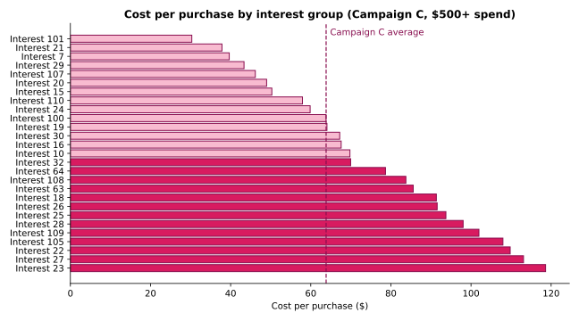
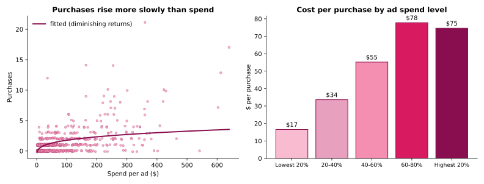

# Facebook Ad Campaign Performance: Where Should the Budget Go?

An analysis of 1,143 Facebook ads across three campaigns: which campaign and audiences turn spend into purchases most efficiently, whether spending more keeps paying off, and how the same budget could buy more customers.

**Python · pandas · matplotlib · statsmodels · marketing analytics · cost per acquisition · funnel metrics · bootstrap · log-log regression**

## Questions

1. Which of the company's three ad campaigns turns spend into customers most efficiently?
2. Which audiences (age, gender, interest) are cheapest to convert?
3. Does spending more on an ad keep paying off, or do returns fall?
4. How could the same budget buy more conversions?

## Data

*Sales Conversion Optimization* dataset, published on Kaggle: 1,143 Facebook ads from three campaigns run by an anonymous company. A copy is included in `data/`.

- Each ad's audience: age group (30 to 49), gender and one of 40 anonymised interest categories
- Results: impressions, clicks, spend, inquiries and purchases
- No missing values or duplicates. The dataset does not state its currency or dates; $ is used throughout.

The main measure is **cost per purchase** (spend divided by purchases, also called cost per acquisition or CPA). There is no revenue column, so return on ad spend cannot be calculated.

## Method

1. **Data checks.** Found 207 ads with zero spend that still recorded conversions, and 218 ads with more inquiries than clicks (view-through attribution), and decided how to treat each.
2. **Funnel metrics.** Click-through rate, cost per click, cost per inquiry, cost per purchase and inquiry-to-purchase rate, overall and by campaign.
3. **Audience comparison.** Cost per purchase by age, gender and interest within the largest campaign, with 5,000-sample bootstrap confidence intervals.
4. **Diminishing returns.** Log-log regression of purchases on spend, controlling for age and gender, plus cost per purchase by spend level.
5. **Budget scenario.** Moved half of the budget from the more expensive interest groups to the cheaper ones, under an optimistic and a cautious assumption.

## Key findings

**1. Campaign C takes 95% of the budget but delivers 81% of purchases.**

| Campaign | Share of spend | Share of purchases | Cost per purchase |
|---|---|---|---|
| A | 0.3% | 2% | $6.24 |
| B | 5% | 17% | $15.81 |
| C | **95%** | **81%** | **$63.83** |

Part of that gap is the cost of running at a much larger scale (see finding 4).



**2. Younger audiences are far cheaper to convert, but the budget does not follow.** In Campaign C, 30 to 34 year olds cost **$37 per purchase** and 45 to 49 year olds **$113**, with bootstrap intervals that do not overlap. Yet the 45 to 49 group received the most budget of any age group. Men cost $49 per purchase and women $82, while women received 58% of the spend.



**3. Interest groups differ fourfold.** Among the 27 groups with at least $500 of spend, cost per purchase runs from $30 to $119. Interest 29 received $4,767 at $43 per purchase; interest 27 received a similar $4,863 at $113.



**4. Returns diminish with spend.** The estimated elasticity of purchases with respect to spend is **0.27** (95% CI 0.23 to 0.31): doubling an ad's spend is associated with only about 20% more purchases. Ads in the lowest-spending fifth bought purchases at $17 each; ads in the top two fifths at $75 to $78.



**5. Reallocating 20% of Campaign C's budget could add 2% to 10% more purchases** at no extra cost, depending on how quickly costs rise in the cheaper groups.

## Recommendations

- Rebalance Campaign C toward 30 to 39 year olds and the cheaper interest groups (such as 29, 20 and 15), and away from groups like 27 and 28.
- Cap the budget of individual ads and spread it across more ads, since each extra dollar on a large ad buys less.
- Test the reallocation on part of the budget for a few weeks before committing, as an A/B test.
- Start tracking revenue per purchase, so return on ad spend can be measured and higher-cost audiences can be judged on what they spend.

## Limitations

- **No revenue data.** An audience that costs more per purchase could still be worth it if those customers spend more.
- **Conversions are Facebook's attributions,** including view-through conversions and conversions credited to ads that never ran, so they likely overstate what the ads caused.
- **Observational data.** Audiences and budgets were chosen by the company, not assigned at random, so differences may partly reflect how ads were set up.
- **Interest categories are anonymous numbers.**
- **Unknown currency and dates.**

## Repository structure

```
├── ad_campaign_analysis.ipynb        # full analysis with code, outputs and written interpretation
├── data/
│   └── facebook_ad_campaigns.csv     # one row per ad
└── images/                           # charts used in this README
```

## How to run

```bash
pip install pandas numpy matplotlib statsmodels jupyter
jupyter notebook ad_campaign_analysis.ipynb
```

Run all cells from the repository folder.

---

**Author:** María Sofía Montoya-Chang · M.S. in Data Analytics · [LinkedIn](https://www.linkedin.com/in/maria-montoya-chang)

Data: *Sales Conversion Optimization* dataset, Kaggle.
